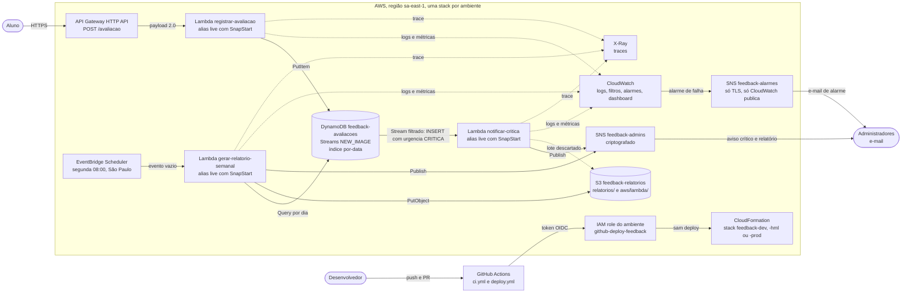

# Plataforma de feedback serverless

Tech Challenge da Fase 4 da pós-graduação em Arquitetura e Desenvolvimento Java da FIAP. Estudantes avaliam aulas pelo endpoint `POST /avaliacao`, com uma descrição e uma nota de 0 a 10. Quando a avaliação é crítica, os administradores recebem um e-mail na hora, e toda segunda-feira recebem um relatório com a consolidação da semana anterior.

O relatório de entrega, no modelo da FIAP, está em [docs/relatorio-tech-challenge.md](docs/relatorio-tech-challenge.md). Este README resume e aponta para os documentos de detalhe; o índice completo está em [Documentação](#documentação).

## Arquitetura

Três funções Lambda em Java 25 com SnapStart, na região `sa-east-1`. Cada ambiente (`dev`, `hml` e `prod`) é uma stack do mesmo template SAM, com os nomes de recurso terminados no sufixo do ambiente.



| Função | Gatilho | Responsabilidade |
|---|---|---|
| `registrar-avaliacao` | API Gateway, `POST /avaliacao` | Validar a entrada, classificar a urgência e persistir |
| `notificar-critica` | DynamoDB Streams, só criação com urgência `CRITICA` | Avisar administradores sobre avaliação crítica |
| `gerar-relatorio-semanal` | EventBridge Scheduler, segunda às 08:00 em São Paulo | Consolidar a semana e publicar o relatório |

A urgência sai da nota: 0 a 3 é `CRITICA`, 4 a 6 é `MEDIA` e 7 a 10 é `BAIXA`. Contrato, permissões, variáveis e erros de cada função estão em [docs/funcoes.md](docs/funcoes.md). A escolha do modelo serverless e o papel de cada componente estão na seção Modelo de cloud do [relatório](docs/relatorio-tech-challenge.md).

## Estado por ambiente

**Estado em 11/11/2026 (UTC).** Datas em UTC, como nos registros citados. "Ativa e conferida" quer dizer que a função rodou pelo gatilho real ou pelo alias `live` e que o resultado foi comparado com a spec no registro da coluna Fonte.

| Função | Ambiente | Estado | Última conferência | Fonte |
|---|---|---|---|---|
| `registrar-avaliacao` | dev | Implantada, sem conferência funcional desde o deploy de 10/11/2026 (UTC). A versão anterior foi conferida | 06/11/2026 (UTC) | [QA de add-observabilidade-seguranca](openspec/changes/archive/2026-11-11-add-observabilidade-seguranca/qa.md), seção "Conferência em dev", itens 6.4 e 6.15. Antes, [QA de add-registro-avaliacao](openspec/changes/archive/2026-11-11-add-registro-avaliacao/qa.md), itens 6.3 a 6.7, de 05/11/2026 |
| `notificar-critica` | dev | Implantada, sem conferência funcional desde o deploy de 10/11/2026 (UTC). A versão anterior foi conferida | 06/11/2026 (UTC) | [QA de add-observabilidade-seguranca](openspec/changes/archive/2026-11-11-add-observabilidade-seguranca/qa.md), seção "Conferência em dev", itens 6.4, 6.11 e 6.15. Antes, [QA de add-notificacao-critica](openspec/changes/archive/2026-11-11-add-notificacao-critica/qa.md), seção "Conferência na stack" |
| `gerar-relatorio-semanal` | dev | Implantada, sem conferência funcional desde o deploy de 10/11/2026 (UTC). A versão anterior foi conferida na execução agendada de 09/11/2026 | 11/11/2026 (UTC) | [QA de add-relatorio-semanal](openspec/changes/archive/2026-11-11-add-relatorio-semanal/qa.md), seção "Execução agendada real, 09/11/2026" |
| `registrar-avaliacao` | hml | Ativa e conferida | 07/11/2026 (UTC) | [QA de add-fundacao-projeto](openspec/changes/archive/2026-11-11-add-fundacao-projeto/qa.md), seção "Release 1.0.0 em hml (07/11/2026)", itens 1 e 2 |
| `notificar-critica` | hml | Ativa e conferida | 07/11/2026 (UTC) | [QA de add-fundacao-projeto](openspec/changes/archive/2026-11-11-add-fundacao-projeto/qa.md), seção "Release 1.0.0 em hml (07/11/2026)", itens 1 e 2 |
| `gerar-relatorio-semanal` | hml | Ativa e conferida no acionamento manual de 07/11/2026 e na execução agendada de 09/11/2026 | 11/11/2026 (UTC) | [QA de add-relatorio-semanal](openspec/changes/archive/2026-11-11-add-relatorio-semanal/qa.md), seção "Execução agendada real, 09/11/2026", e [QA de add-fundacao-projeto](openspec/changes/archive/2026-11-11-add-fundacao-projeto/qa.md), seção "Release 1.0.0 em hml (07/11/2026)", item 3 |
| `registrar-avaliacao` | prod | Implantada, sem conferência funcional. Alias `live` em `Active`, SnapStart `On` e nenhuma invocação desde o deploy | 11/11/2026 (UTC) | [QA de add-observabilidade-seguranca](openspec/changes/archive/2026-11-11-add-observabilidade-seguranca/qa.md), seção "Prod, release 1.0.0 (leitura)", e a execução 42438770120 do workflow Deploy |
| `notificar-critica` | prod | Implantada, sem conferência funcional. Alias `live` em `Active`, SnapStart `On` e nenhuma invocação desde o deploy | 11/11/2026 (UTC) | [QA de add-observabilidade-seguranca](openspec/changes/archive/2026-11-11-add-observabilidade-seguranca/qa.md), seção "Prod, release 1.0.0 (leitura)", e a execução 42438770120 do workflow Deploy |
| `gerar-relatorio-semanal` | prod | Ativa e conferida na execução agendada de 09/11/2026 | 11/11/2026 (UTC) | [QA de add-relatorio-semanal](openspec/changes/archive/2026-11-11-add-relatorio-semanal/qa.md), seção "Execução agendada real, 09/11/2026", e [QA de add-observabilidade-seguranca](openspec/changes/archive/2026-11-11-add-observabilidade-seguranca/qa.md), seção "Prod, release 1.0.0 (leitura)" |

- Na execução agendada de 09/11/2026, cada ambiente gravou `relatorios/2026-11-09.txt` idêntico, byte a byte, ao texto montado a partir da tabela, e o aviso foi entregue no tópico de administradores. Em prod, a semana estava vazia.
- A stack `feedback-dev` recebeu um deploy às 21:35 UTC de 10/11/2026 (execução 42906193011 do workflow Deploy, merge do PR #16), depois das conferências acima, e o alias `live` das três funções de dev passou a apontar para versões novas. A leitura de 11/11/2026 (UTC), na seção "Leitura de dev e hml (tarefa 2.1)" do [QA de add-documentacao-entrega](openspec/changes/archive/2026-11-11-add-documentacao-entrega/qa.md), encontrou as três em `Active`, SnapStart `On` e 1024 MB, sem invocação desde o deploy e com a tabela de dev inalterada. Essas versões não têm conferência funcional.
- A tabela não cita número de versão, porque cada deploy publica versões novas das funções.
- hml pode ser removido depois da entrega, em 13/11/2026, e prod fica no ar até a divulgação da nota da FIAP. Nos dois casos, o bucket é esvaziado antes do `sam delete`, como em [7. Remover uma stack](#7-remover-uma-stack). Essas remoções acontecem depois desta versão do README e não aparecem na tabela.

## Documentação

| Documento | O que tem |
|---|---|
| [docs/relatorio-tech-challenge.md](docs/relatorio-tech-challenge.md) | Relatório no modelo da FIAP: introdução, arquitetura, endpoints com exemplos, configuração do projeto, execução local com `sam local`, qualidade do código, coleção Postman, repositório, modelo de cloud |
| [docs/funcoes.md](docs/funcoes.md) | As três funções: gatilho, entrada, saída, regras, erros, variáveis de ambiente, permissões IAM, memória, timeout, SnapStart, métricas, logs, reprocessamento do aviso e acionamento manual do relatório |
| [docs/seguranca.md](docs/seguranca.md) | OIDC, roles de deploy e boundary, criptografia, TLS, dado do aluno, isolamento entre ambientes, governança do GitHub e o registro de riscos aceitos |
| [docs/monitoramento.md](docs/monitoramento.md) | Logs, métricas, os três alarmes, dashboard, X-Ray, como testar um alarme e os limites do nível gratuito |
| [docs/roteiro-video.md](docs/roteiro-video.md) | Roteiro da gravação em prod, com preparação, blocos com tempo e cuidados com o que aparece na tela |
| [docs/postman/feedback-serverless.postman_collection.json](docs/postman/feedback-serverless.postman_collection.json) | Coleção Postman de `POST /avaliacao`. Como configurar está em [Como usar o endpoint](#como-usar-o-endpoint) |
| [CHANGELOG.md](CHANGELOG.md) | O que entrou em cada versão |
| [docs/incidentes/2026-11-04-snapstart-aspectjrt.md](docs/incidentes/2026-11-04-snapstart-aspectjrt.md) | Incidente dos primeiros deploys em dev: SnapStart, `aspectjrt` e permissão de tag no Stage da API |
| [openspec/project.md](openspec/project.md) | Contexto, regras de domínio, Gitflow e pendências pós-entrega |

As specs consolidadas ficam em `openspec/specs/`, uma por capability. Os registros de QA, com a evidência de cada conferência na AWS, ficam no `qa.md` de cada change: [add-fundacao-projeto](openspec/changes/archive/2026-11-11-add-fundacao-projeto/qa.md), [add-registro-avaliacao](openspec/changes/archive/2026-11-11-add-registro-avaliacao/qa.md), [add-notificacao-critica](openspec/changes/archive/2026-11-11-add-notificacao-critica/qa.md), [add-relatorio-semanal](openspec/changes/archive/2026-11-11-add-relatorio-semanal/qa.md) e [add-observabilidade-seguranca](openspec/changes/archive/2026-11-11-add-observabilidade-seguranca/qa.md).

Onde achar cada critério de avaliação:

| Critério | Onde |
|---|---|
| Modelo de cloud e componentes | [Arquitetura](#arquitetura) e a seção Modelo de cloud do [relatório](docs/relatorio-tech-challenge.md) |
| Funcionamento da aplicação | [Estado por ambiente](#estado-por-ambiente), [Como usar o endpoint](#como-usar-o-endpoint) e o [roteiro do vídeo](docs/roteiro-video.md) |
| Qualidade do código e documentação | Seção Qualidade do código do [relatório](docs/relatorio-tech-challenge.md), [Como buildar e testar](#como-buildar-e-testar) e esta tabela |
| Arquitetura, deploy, monitoramento e funções | [Arquitetura](#arquitetura), [Implantação numa conta nova](#implantação-numa-conta-nova), [docs/monitoramento.md](docs/monitoramento.md) e [docs/funcoes.md](docs/funcoes.md) |
| Configuração da nuvem e das funções, com segurança | [docs/seguranca.md](docs/seguranca.md), [docs/funcoes.md](docs/funcoes.md) e o [template.yaml](template.yaml) |

## Como buildar e testar

Requisitos: JDK 25 no `JAVA_HOME`, Maven 3.9 ou superior e SAM CLI, usado na versão 1.171.0. Confira com `mvn -v` que o Maven roda em Java 25: com um JDK 21 o build falha. Rode da raiz do repositório.

Registro: `mvn -B verify` na seção "Release 1.0.0 em hml (07/11/2026)", "Verificações locais", do [QA de add-fundacao-projeto](openspec/changes/archive/2026-11-11-add-fundacao-projeto/qa.md); os demais na seção "Verificações locais (tarefa 5.3)" do [QA de add-observabilidade-seguranca](openspec/changes/archive/2026-11-11-add-observabilidade-seguranca/qa.md), com OpenJDK 25 e SAM CLI 1.171.0.

```bash
mvn -B verify
mvn -B install
sam build
sam validate --lint --region sa-east-1
sam validate --lint --region sa-east-1 -t infra/bootstrap/github-oidc.yaml
```

- `mvn -B verify` compila e roda os testes de todos os módulos. Os números de testes estão na seção Qualidade do código do [relatório](docs/relatorio-tech-challenge.md).
- O `install` vem antes do `sam build`, porque o SAM copia só a pasta de cada função e resolve o parent e o módulo `dominio` pelo `~/.m2`. Sem ele, o `sam build` falha com `JavaMavenWorkflow:MavenBuild - Maven Failed`.
- No Git Bash do Windows, o SAM pode precisar ser chamado como `sam.cmd`.
- A execução local com `sam local invoke` está em [Execução local com `sam local`](#execução-local-com-sam-local), mais abaixo, e não foi executada, porque o Docker não estava disponível na máquina de desenvolvimento.

**No pull request**, o workflow `.github/workflows/ci.yml` roda em todo PR para `develop`, `release/**` e `main`, sem credencial da AWS: `mvn -B install` com os testes, `sam build` e os dois `sam validate --lint`. O job se chama `ci` e é o check obrigatório da proteção de `main` e `develop`. O CI e o deploy usam o JDK Corretto 25.

### Execução local com `sam local`

O `sam local invoke` roda uma função num contêiner com a imagem do runtime `java25`, a partir do que o `sam build` empacotou. O exemplo usa `RegistrarAvaliacao` com uma entrada inválida, porque esse caminho responde sem chamar nenhum serviço da AWS.

Salve os dois arquivos abaixo numa pasta fora do repositório e troque `CAMINHO` pelo caminho dela no comando.

`evento-entrada-invalida.json`, evento de HTTP API no formato 2.0 com `descricao` vazia e `nota` 11:

```json
{
  "version": "2.0",
  "routeKey": "POST /avaliacao",
  "rawPath": "/avaliacao",
  "headers": {
    "content-type": "application/json"
  },
  "requestContext": {
    "http": {
      "method": "POST",
      "path": "/avaliacao"
    },
    "requestId": "local-entrada-invalida"
  },
  "body": "{\"descricao\": \"\", \"nota\": 11}",
  "isBase64Encoded": false
}
```

`variaveis.json`, com um nome de tabela que não existe na conta. Se o caminho um dia chegasse a chamar o DynamoDB, a chamada falharia em vez de gravar em dev:

```json
{"RegistrarAvaliacao": {"TABELA_AVALIACOES": "feedback-avaliacoes-local"}}
```

Não executado: o Docker não estava disponível na máquina de desenvolvimento, e por decisão do Gabriel de 10/11/2026 a execução local fica documentada sem ter rodado. No Git Bash do Windows, o comando pode precisar ser `sam.cmd`.

```bash
mvn -B install
sam build
sam local invoke RegistrarAvaliacao \
  --event CAMINHO/evento-entrada-invalida.json \
  --env-vars CAMINHO/variaveis.json \
  --parameter-overrides Stage=dev
```

Resultado esperado, pela leitura do handler e pelos testes de `RegistrarAvaliacaoHandlerTest`, sem execução local que o confirme: resposta com `statusCode` 400 e, no `body`, o JSON abaixo. No terminal aparecem a linha de log `Entrada rejeitada` em INFO, com `campos` e sem os valores enviados, e a métrica `EntradaRejeitada` no formato EMF.

```json
{"erro":"ENTRADA_INVALIDA","mensagem":"Um ou mais campos são inválidos.","campos":["descricao","nota"]}
```

O que exige: Docker em execução, o `sam build` antes e, na primeira vez, o download da imagem do runtime. Não exige credencial.

O que acessa na AWS: nada, pela leitura do código. O handler cria o cliente do DynamoDB, mas a validação rejeita a entrada antes de qualquer chamada. O log e as métricas vão para o terminal, não para o CloudWatch.

O que a execução local não reproduz:
- SnapStart, snapshot e restauração, e o aquecimento dos clientes, que só roda no `beforeCheckpoint`
- alias `live` e versões publicadas
- API Gateway real, com a rota e o limite de taxa
- IAM, as roles das funções e o boundary
- os gatilhos reais: Streams com filtro e Scheduler
- envio de traces ao X-Ray
- métricas, filtros de log, alarmes e retenção no CloudWatch
- a CPU proporcional à memória configurada

## Como usar o endpoint

O endpoint não tem autenticação, decisão de escopo registrada como risco aceito em [docs/seguranca.md](docs/seguranca.md). A URL fica no output `ApiAvaliacoesUrl` da stack, no formato `https://<ID_DA_API>.execute-api.sa-east-1.amazonaws.com/avaliacao`, já com o caminho. O comando abaixo lê a URL para uma variável, sem escrevê-la em arquivo, e envia uma avaliação. Troque `feedback-dev` pela stack do ambiente.

Registro: envio com a URL do output `ApiAvaliacoesUrl` em dev, no item 6.6 do [QA de add-registro-avaliacao](openspec/changes/archive/2026-11-11-add-registro-avaliacao/qa.md), e em hml, nos itens 1 e 2 da seção "Release 1.0.0 em hml (07/11/2026)" do [QA de add-fundacao-projeto](openspec/changes/archive/2026-11-11-add-fundacao-projeto/qa.md).

```bash
URL=$(aws cloudformation describe-stacks \
  --stack-name feedback-dev \
  --query "Stacks[0].Outputs[?OutputKey=='ApiAvaliacoesUrl'].OutputValue" \
  --output text \
  --region sa-east-1 \
  --profile tc4-admin)

curl -i -X POST "$URL" \
  -H "Content-Type: application/json" \
  -d '{"descricao": "Aula muito boa", "nota": 9}'
```

A resposta é `201` com o `id` gerado e a urgência:

```json
{"id":"<UUID>","urgencia":"BAIXA"}
```

- Com nota de 0 a 3, a avaliação é `CRITICA` e gera um e-mail real aos administradores do ambiente.
- Os quatro casos de resposta (201, 400 `ENTRADA_INVALIDA`, 400 `CORPO_INVALIDO` e 500 `ERRO_INTERNO`), com requisição e corpo de cada um, estão na seção Endpoints do [relatório](docs/relatorio-tech-challenge.md).
- Para a [coleção Postman](docs/postman/feedback-serverless.postman_collection.json), importe o arquivo e defina a variável de coleção `baseUrl` com a URL **sem** o `/avaliacao` do final, porque cada requisição já monta `{{baseUrl}}/avaliacao`. Quantas requisições ela tem e onde rodou está na seção Collections para teste do [relatório](docs/relatorio-tech-challenge.md).

## Implantação numa conta nova

Os passos seguem a ordem em que são feitos. Os comandos da AWS usam o perfil administrativo `tc4-admin`; numa conta nova, troque pelo seu perfil. Foram escritos para o Git Bash e rodam da raiz do repositório.

### 1. Bootstrap do OIDC e das roles

O template `infra/bootstrap/github-oidc.yaml` cria, na stack `feedback-bootstrap-oidc`, o provedor OIDC do GitHub, uma role de deploy `github-deploy-feedback-<amb>` por ambiente e o boundary `feedback-limite-funcoes-<amb>`, teto das roles das funções. Ele é aplicado com credencial administrativa e fica fora do pipeline, para que o pipeline não consiga alterar as próprias permissões. O que cada role pode e não pode fazer está em [docs/seguranca.md](docs/seguranca.md).

Antes, confira com `aws iam list-open-id-connect-providers --profile tc4-admin` se a conta já tem o provedor `token.actions.githubusercontent.com`. Uma conta só aceita um provedor por URL. Se ele existir, acrescente `--parameter-overrides CriarProvedorOidc=false` ao comando abaixo, para o template reaproveitá-lo.

Registro: bootstrap aplicado pelo Gabriel em 04/11/2026, com as roles e a trust policy conferidas na matriz `entrega-continua` do [QA de add-fundacao-projeto](openspec/changes/archive/2026-11-11-add-fundacao-projeto/qa.md); reaplicado em 05/11/2026, conforme a seção "Segunda falha: permissão de tag no Stage da API" do [incidente de 04/11/2026](docs/incidentes/2026-11-04-snapstart-aspectjrt.md).

```bash
AWS_CLI_FILE_ENCODING=UTF-8 aws cloudformation deploy \
  --stack-name feedback-bootstrap-oidc \
  --template-file infra/bootstrap/github-oidc.yaml \
  --capabilities CAPABILITY_NAMED_IAM CAPABILITY_AUTO_EXPAND \
  --region sa-east-1 \
  --profile tc4-admin
```

- `CAPABILITY_AUTO_EXPAND` é necessário porque o template usa a transform `AWS::LanguageExtensions` para gerar os três ambientes. Por isso o bootstrap usa `aws cloudformation deploy`, e não `sam deploy`.
- `AWS_CLI_FILE_ENCODING=UTF-8` evita que a CLI leia o template em CP1252, o padrão do Windows, e corrompa os acentos.
- Se a criação falhar, a stack fica em `ROLLBACK_COMPLETE` e precisa ser removida com `aws cloudformation delete-stack` antes de tentar de novo.
- Os ARNs das roles saem nos outputs `RoleDeployDevArn`, `RoleDeployHmlArn` e `RoleDeployProdArn`, usados no passo 3.

**Atualizar o bootstrap depois.** As roles de deploy negam a si mesmas qualquer mudança no bootstrap, então a atualização é sempre com o perfil administrativo. Acrescente `--no-execute-changeset` ao comando acima: a CLI cria o change set e termina sem executá-lo. Revise e aplique com o ARN que ela mostrar.

Não executado como está escrito: o procedimento foi seguido em 06/11/2026, na tarefa 2.3 de `add-observabilidade-seguranca`, e o resultado está na seção "Roles de deploy e manutenção do bootstrap" de [docs/seguranca.md](docs/seguranca.md), mas os comandos não foram registrados num `qa.md`.

```bash
aws cloudformation describe-change-set \
  --change-set-name "<ARN_DO_CHANGE_SET>" \
  --region sa-east-1 \
  --profile tc4-admin

aws cloudformation execute-change-set \
  --change-set-name "<ARN_DO_CHANGE_SET>" \
  --region sa-east-1 \
  --profile tc4-admin
```

### 2. Service-linked role do API Gateway

Passo manual, uma vez por conta, antes do primeiro deploy da aplicação. As roles de deploy não têm `iam:CreateServiceLinkedRole`, de propósito, e o primeiro deploy em dev registrou essa ação negada pouco antes da falha do Stage da API. Confira antes com `aws iam get-role --role-name AWSServiceRoleForAPIGateway --profile tc4-admin`; se a role existir, pule este passo.

Registro: role criada pelo Gabriel em 05/11/2026, conforme a seção "Dúvida que continua em aberto" do [incidente de 04/11/2026](docs/incidentes/2026-11-04-snapstart-aspectjrt.md).

```bash
aws iam create-service-linked-role --aws-service-name ops.apigateway.amazonaws.com --profile tc4-admin
```

### 3. Ambientes do GitHub

Crie os ambientes `dev`, `hml` e `prod` no repositório, cada um com uma variável e um secret, e com a restrição de branch e as regras abaixo. Nenhum desses valores vai para arquivo versionado.

| Nome | Tipo | Valor |
|---|---|---|
| `AWS_ROLE_ARN` | variável | ARN da role do ambiente, do output do passo 1 |
| `EMAIL_ADMIN` | secret | E-mail que assina os tópicos de administradores e de alarmes do ambiente |

| Ambiente | Branches aceitas | Regras |
|---|---|---|
| `dev` | `develop` | política de branch |
| `hml` | `release/*` | política de branch |
| `prod` | `main` | revisor obrigatório `g-andradd`, sem "prevent self-review", e política de branch |

Sem `EMAIL_ADMIN`, o job de deploy falha antes do `sam deploy`, com uma mensagem que cita o secret. Os valores lidos no GitHub, inclusive a proteção de `main` e `develop`, estão na seção "Proteção de branch, ambientes do GitHub e aprovação em prod" de [docs/seguranca.md](docs/seguranca.md).

Os comandos abaixo mostram os ARNs, gravam a variável e gravam o secret sem deixar o e-mail no histórico do terminal: digite o endereço quando o `read` aguardar. Repita a variável e o secret para `hml` e `prod`, trocando `--env` e o ARN.

Não executado como está escrito: os três ambientes foram configurados com `gh` em 03/11/2026, e o [QA de add-fundacao-projeto](openspec/changes/archive/2026-11-11-add-fundacao-projeto/qa.md) conferiu em 04/11/2026, pelos nomes, a variável e o secret em cada um (cenário "Repositório sem secrets AWS") e a restrição de branch (seção "Decisões do Gabriel sobre as observações").

```bash
aws cloudformation describe-stacks \
  --stack-name feedback-bootstrap-oidc \
  --query "Stacks[0].Outputs[?starts_with(OutputKey, 'RoleDeploy')].[OutputKey,OutputValue]" \
  --output table \
  --region sa-east-1 \
  --profile tc4-admin

gh variable set AWS_ROLE_ARN --env dev --body "<ARN_DA_ROLE_DE_DEV>" --repo g-andradd/fiap-tc4-feedback-serverless

read -rs EMAIL_ADMIN
printf '%s' "$EMAIL_ADMIN" | gh secret set EMAIL_ADMIN --env dev --repo g-andradd/fiap-tc4-feedback-serverless
unset EMAIL_ADMIN
```

### 4. Deploy por branch

O workflow `.github/workflows/deploy.yml` roda a cada push nas branches abaixo. O job `resolver-ambiente` escolhe o ambiente pela branch, e o job `deploy` assume a role do ambiente por OIDC e roda `mvn -B install`, `sam build --config-env <amb>` e `sam deploy --config-env <amb>`, passando `Stage` e o e-mail do secret. Cada ambiente tem um deploy por vez.

| Branch | Ambiente do GitHub | Stack | Seção do `samconfig.toml` | Primeiro deploy |
|---|---|---|---|---|
| `develop` | `dev` | `feedback-dev` | `dev` | 04/11/2026, execução 41766334040 |
| `release/*` | `hml` | `feedback-hml` | `hml` | 07/11/2026, execução 42335524756 |
| `main` | `prod` | `feedback-prod` | `prod` | 08/11/2026, execução 42438770120 |

`feature/*` e `hotfix/*` não disparam deploy: a feature passa só pelo CI no PR para `develop`, e o hotfix entra em `main` por PR. O fluxo de branches está em [openspec/project.md](openspec/project.md), seção Ambientes e Gitflow.

### 5. Aprovação manual em prod

O job `deploy` de prod roda no ambiente `prod` do GitHub, que exige a revisão de `g-andradd`. A execução fica em espera na página do workflow, em Actions, até alguém com permissão aprovar o deploy. Administradores do repositório podem pular essa espera: é o risco aceito R06 de [docs/seguranca.md](docs/seguranca.md).

### 6. Confirmação das assinaturas de e-mail

O primeiro deploy de cada stack cria duas assinaturas por e-mail para o endereço de `EMAIL_ADMIN`: uma no tópico de administradores (aviso crítico e relatório) e outra no tópico de alarmes. O SNS manda um e-mail de confirmação para cada uma. Até alguém clicar no link, as funções e os alarmes publicam e ninguém recebe. Repita em cada ambiente.

Registro: leitura de `SubscriptionsConfirmed` e `SubscriptionsPending` nos dois tópicos de hml e de prod, nas seções "8.1. Assinaturas de hml" e "8.1. Assinaturas de prod" do [QA de add-observabilidade-seguranca](openspec/changes/archive/2026-11-11-add-observabilidade-seguranca/qa.md).

```bash
STACK=feedback-dev

for SAIDA in TopicoAdminsArn TopicoAlarmesArn; do
  ARN=$(aws cloudformation describe-stacks \
    --stack-name "$STACK" \
    --query "Stacks[0].Outputs[?OutputKey=='$SAIDA'].OutputValue" \
    --output text \
    --region sa-east-1 \
    --profile tc4-admin)
  echo "$SAIDA"
  aws sns get-topic-attributes \
    --topic-arn "$ARN" \
    --query "Attributes.[SubscriptionsConfirmed,SubscriptionsPending]" \
    --output text \
    --region sa-east-1 \
    --profile tc4-admin
done
```

Esperado: `1` e `0` nos dois tópicos. Com `0` e `1`, a confirmação ainda não foi feita. O SNS descarta a assinatura pendente depois de um prazo, e um deploy sem mudança no template não a recria (risco R05 de [docs/seguranca.md](docs/seguranca.md)).

### 7. Remover uma stack

O CloudFormation só exclui bucket vazio, então o bucket de relatórios precisa ser esvaziado antes do `sam delete`. Rode com o perfil administrativo, porque as roles de deploy não excluem a stack. Plano: hml pode ser removido depois da entrega, em 13/11/2026, e prod só depois da divulgação da nota da FIAP.

Não executado: até 11/11/2026, nenhuma stack foi removida e o procedimento não rodou em nenhum ambiente.

```bash
STACK=feedback-hml

BUCKET=$(aws cloudformation describe-stacks \
  --stack-name "$STACK" \
  --query "Stacks[0].Outputs[?OutputKey=='BucketRelatoriosNome'].OutputValue" \
  --output text \
  --region sa-east-1 \
  --profile tc4-admin)

aws s3 ls "s3://$BUCKET/" --recursive --region sa-east-1 --profile tc4-admin

aws s3 rm "s3://$BUCKET/" --recursive --region sa-east-1 --profile tc4-admin

sam delete --stack-name "$STACK" --region sa-east-1 --profile tc4-admin
```

- O `aws s3 ls` mostra o que vai ser apagado. Baixe antes o que quiser guardar: o `aws s3 rm` remove todos os objetos, de `relatorios/` e de `aws/lambda/`, e o bucket não tem versionamento.
- O `sam delete` remove a stack inteira, inclusive a tabela de avaliações, que tem `DeletionPolicy: Delete`. Sem `--no-prompts`, ele pede confirmação. No Git Bash do Windows, pode precisar ser `sam.cmd delete`.
- A tabela de prod tem recuperação pontual. Ao ser excluída, ela deixa um backup de sistema, mantido pela AWS por 35 dias.
- Se o bucket receber um objeto novo entre o `aws s3 rm` e o `sam delete`, a exclusão falha. Esvazie de novo e repita.
- Não apague o bucket por fora da stack: com o destino de falha da notificação ainda configurado, outra conta poderia recriar o nome e receber os lotes descartados (risco R18 de [docs/seguranca.md](docs/seguranca.md)).

## Estrutura de pastas e stack

```text
.
├── .github/workflows/            # ci.yml (PR) e deploy.yml (push por branch)
├── docs/                         # relatório, funções, segurança, monitoramento, roteiro
│   ├── incidentes/               # registro de incidentes
│   └── postman/                  # coleção de POST /avaliacao
├── functions/
│   ├── dominio/                  # regras puras, sem SDK da AWS
│   ├── registrar-avaliacao/      # POST /avaliacao
│   ├── notificar-critica/        # aviso de avaliação crítica
│   └── gerar-relatorio-semanal/  # consolidação da semana
├── infra/bootstrap/              # OIDC, roles de deploy e boundary, aplicados uma vez
├── openspec/                     # contexto, specs e changes
├── template.yaml                 # template SAM de um ambiente
├── samconfig.toml                # stack, região e tags por ambiente
└── pom.xml                       # parent Maven
```

- Java 25 e Maven multi-módulo, com o domínio isolado do SDK da AWS e handlers Java puros, sem Spring
- AWS Lambda com SnapStart e alias `live`, API Gateway HTTP API, DynamoDB sob demanda com Streams, SNS, S3 e EventBridge Scheduler
- CloudWatch (logs, métricas, alarmes e dashboard) e X-Ray, com Powertools for AWS Lambda (Java)
- AWS SAM para a infraestrutura como código
- GitHub Actions com autenticação OIDC na AWS
- JUnit 5, AssertJ e Mockito nos testes
