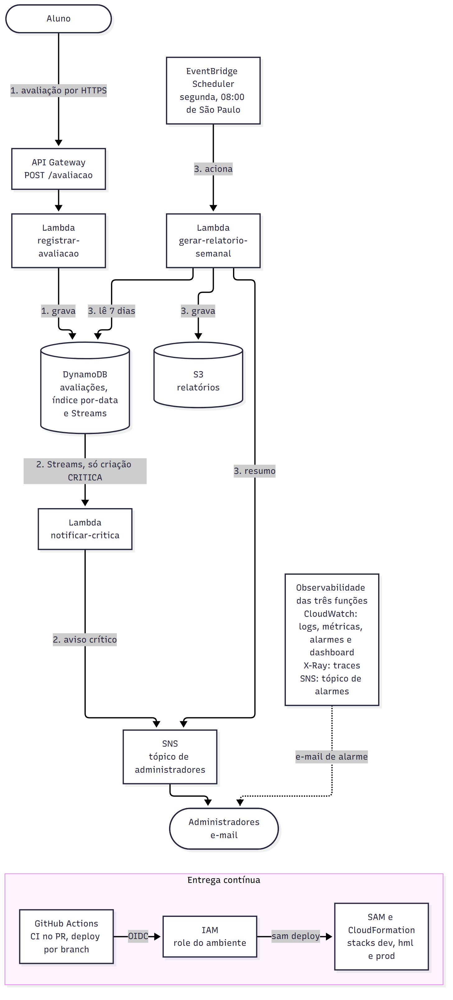

# Relatório do Tech Challenge

Projeto: Plataforma de feedback serverless

Equipe: Gabriel Andrade Almeida, RM371308

Curso: Pós Tech em Arquitetura e Desenvolvimento Java, FIAP, Fase 4

Vídeo de demonstração: [LINK DO VÍDEO]

## 1. Introdução

### Problema

Estudantes avaliam as aulas com uma descrição e uma nota. A coordenação precisa de duas coisas a partir dessas avaliações: saber na hora quando uma aula foi mal avaliada e receber toda semana um resumo do que chegou. O enunciado pede as duas notificações, mas não define o que é uma avaliação urgente nem quando o relatório sai.

### Objetivo

Construir a plataforma em nuvem com funções serverless, cada uma com uma única responsabilidade, implantada por pipeline em três ambientes, com monitoramento e controles de segurança desde o primeiro deploy, dentro do nível gratuito da AWS. A versão descrita é a 1.0.0.

As duas lacunas do enunciado foram resolvidas assim:

| Nota | Urgência | Efeito |
|---|---|---|
| 0 a 3 | `CRITICA` | Aviso imediato por e-mail aos administradores |
| 4 a 6 | `MEDIA` | Entra no relatório semanal |
| 7 a 10 | `BAIXA` | Entra no relatório semanal |

O relatório sai toda segunda-feira às 08:00, horário de São Paulo, e cobre os 7 dias anteriores. A função também pode ser acionada à mão, com uma data de referência opcional.

## 2. Arquitetura do Sistema

### Descrição

São três fluxos, todos na região `sa-east-1` e em uma stack SAM por ambiente:

1. **Registro.** O aluno chama `POST /avaliacao` no API Gateway. A função `registrar-avaliacao` valida o corpo, calcula a urgência pela nota, atribui o identificador e a data de envio e grava o item no DynamoDB.
2. **Aviso crítico.** O DynamoDB Streams entrega cada criação de item à função `notificar-critica`, mas um filtro no mapeamento só deixa passar `INSERT` com `urgencia` igual a `CRITICA`. A função publica no tópico SNS de administradores, que envia o e-mail com descrição, urgência e data de envio. O lote que esgota as tentativas vai para o bucket, em `aws/lambda/`.
3. **Relatório semanal.** O EventBridge Scheduler aciona `gerar-relatorio-semanal` na segunda às 08:00. A função consulta as 7 partições diárias do índice `por-data`, consolida, grava o texto em `relatorios/<dataReferencia>.txt` no S3 e publica no tópico de administradores um aviso com a localização e o resumo, sem descrições nem notas.

Em volta dos três fluxos, todas as funções gravam logs JSON no CloudWatch e enviam traces ao X-Ray. Um filtro de log por função alimenta um alarme de falha, que publica num tópico SNS separado, o de alarmes. O código chega à AWS pelo GitHub Actions, que assume a role do ambiente por OIDC, sem chave de acesso guardada.

### Diagrama



A fonte da imagem é [docs/img/arquitetura.mmd](img/arquitetura.mmd). O diagrama detalhado, com cada recurso e ligação, está em Mermaid no [README.md](../README.md).

### Componentes

Cada recurso leva o sufixo do ambiente (`<amb>` é `dev`, `hml` ou `prod`), definido pelo parâmetro `Stage` do `template.yaml`.

| Componente | Recurso | Papel |
|---|---|---|
| Amazon API Gateway | HTTP API `feedback-api-<amb>` | Rota `POST /avaliacao`, limite de 10 requisições por segundo com rajada de 20 |
| AWS Lambda | `feedback-registrar-avaliacao-<amb>`, `feedback-notificar-critica-<amb>`, `feedback-gerar-relatorio-semanal-<amb>` | Java 25 (`java25`), 1024 MB, alias `live` com SnapStart nas versões publicadas, tracing ativo |
| Amazon DynamoDB | `feedback-avaliacoes-<amb>` | Modo on-demand, chave `id`, índice `por-data` (`dataEnvio` e `criadoEm`), Streams com `NEW_IMAGE`, criptografia em repouso, recuperação pontual só em prod |
| Amazon EventBridge Scheduler | `feedback-relatorio-semanal-<amb>` | `cron(0 8 ? * MON *)` em `America/Sao_Paulo`, até 3 novas tentativas |
| Amazon SNS | `feedback-admins-<amb>` | Aviso crítico e aviso do relatório, assinatura por e-mail, criptografado com `alias/aws/sns` |
| Amazon SNS | `feedback-alarmes-<amb>` | E-mail dos alarmes, separado do tópico de administradores |
| Amazon S3 | `feedback-relatorios-<ID_DA_CONTA>-<amb>` | Relatórios e lotes descartados, privado, criptografado, acesso sem TLS negado |
| Amazon CloudWatch | Grupos de log, 3 filtros, 3 alarmes, dashboard `feedback-painel-<amb>` | Logs, métricas, alarmes e painel do ambiente |
| AWS X-Ray | Tracing ativo nas três funções | Trace de cada invocação, com a restauração do SnapStart e as chamadas ao SDK |
| GitHub Actions e IAM | Workflows `CI` e `Deploy`, roles `github-deploy-feedback-<amb>` | Build e testes no PR, deploy por branch, acesso à AWS por OIDC |

## 3. Descrição dos Endpoints da API

| Método e rota | Caso | Status | Campo `erro` | Grava na tabela |
|---|---|---|---|---|
| `POST /avaliacao` | Avaliação registrada | 201 | | Sim |
| `POST /avaliacao` | Um ou mais campos inválidos | 400 | `ENTRADA_INVALIDA` | Não |
| `POST /avaliacao` | Corpo ausente, malformado ou que não é objeto JSON | 400 | `CORPO_INVALIDO` | Não |
| `POST /avaliacao` | Falha interna ao gravar | 500 | `ERRO_INTERNO` | Não |

Regras do corpo:
- `descricao`: obrigatória, texto com ao menos um caractere diferente de espaço, tabulação ou quebra de linha, até 1000 caracteres. É gravada como recebida.
- `nota`: obrigatória, número JSON inteiro de 0 a 10. `7.0`, `1e1` e `"7"` são rejeitados.
- Campos extras são ignorados. `id`, `urgencia`, `dataEnvio` e `criadoEm` são calculados pela função, mesmo que o cliente os envie.

Todas as respostas têm `content-type: application/json`. A URL vem do output `ApiAvaliacoesUrl` da stack e tem o formato abaixo. O identificador real da API não é publicado.

```text
https://<ID_DA_API>.execute-api.sa-east-1.amazonaws.com/avaliacao
```

### 201, avaliação registrada

```text
POST /avaliacao
Content-Type: application/json

{"descricao": "Aula muito boa", "nota": 9}
```

```json
{"id":"<UUID>","urgencia":"BAIXA"}
```

O `id` é um UUID gerado a cada requisição. Dois envios com o mesmo corpo geram duas avaliações.

### 400, campo inválido

`campos` traz o nome de todos os campos reprovados, nunca o valor enviado.

```text
POST /avaliacao
Content-Type: application/json

{"descricao": "", "nota": 11}
```

```json
{"erro":"ENTRADA_INVALIDA","mensagem":"Um ou mais campos são inválidos.","campos":["descricao","nota"]}
```

### 400, corpo inválido

Vale para corpo ausente ou vazio, JSON truncado, JSON que não é objeto (como `[1, 2, 3]`) e objeto seguido de outros tokens.

```text
POST /avaliacao
Content-Type: application/json

{"descricao": "Aula boa", "nota": 5
```

```json
{"erro":"CORPO_INVALIDO","mensagem":"O corpo da requisição precisa ser um objeto JSON válido.","campos":[]}
```

### 500, falha interna

A requisição é válida, mas a gravação falhou. A mensagem é fixa, sem exceção, pilha ou nome de recurso.

```text
POST /avaliacao
Content-Type: application/json

{"descricao": "Aula muito boa", "nota": 9}
```

```json
{"erro":"ERRO_INTERNO","mensagem":"Não foi possível registrar a avaliação. Tente novamente."}
```

Os casos 201 e 400 foram exercitados na stack de dev em 05/11/2026, e o 201 também em hml em 07/11/2026. O 500 tem prova só nos testes do handler, com o DynamoDB simulado, porque uma requisição não consegue provocar a falha de gravação. Acima do limite de taxa, o próprio API Gateway responde 429, sem invocar a função; esse caso está configurado no template e não foi provocado.

## 4. Configuração do Projeto

### SAM no lugar do Docker Compose

Não há contêiner nem servidor para orquestrar. O que o Docker Compose faria num projeto com serviços próprios, aqui é feito pelo AWS SAM:

- `template.yaml` descreve um ambiente inteiro: API, três funções, tabela, tópicos, bucket, agendamento, grupos de log, filtros, alarmes e dashboard. O único parâmetro que muda entre ambientes é `Stage`, mais o e-mail dos administradores, que chega pelo pipeline.
- `samconfig.toml` tem uma seção por ambiente, com o nome da stack (`feedback-dev`, `feedback-hml`, `feedback-prod`), a região, o prefixo dos artefatos e as tags `projeto` e `ambiente`.
- O `Globals` do template aplica a todas as funções o runtime `java25`, 1024 MB, timeout padrão de 30 s, tracing ativo, alias `live`, SnapStart nas versões publicadas e o permissions boundary do ambiente.

### Pipelines

| Workflow | Quando roda | O que faz |
|---|---|---|
| `.github/workflows/ci.yml` | PR para `develop`, `release/**` e `main` | `mvn -B install` com os testes, `sam build` e `sam validate --lint` nos dois templates. Sem credencial da AWS. O job `ci` é o check obrigatório da proteção de branch |
| `.github/workflows/deploy.yml` | Push em `develop`, `release/**` e `main` | Resolve o ambiente pela branch, assume a role do ambiente por OIDC, roda `mvn -B install`, `sam build` e `sam deploy`. Um deploy por ambiente de cada vez |

O e-mail dos administradores vem do secret `EMAIL_ADMIN` do ambiente no GitHub e entra no parâmetro `EmailAdmin`, que tem `NoEcho`. Sem o secret, o job falha antes do `sam deploy`.

### Ambientes e Gitflow

| Branch | Ambiente | Stack | Deploy |
|---|---|---|---|
| `feature/*` | nenhum | nenhuma | Só o CI no PR |
| `develop` | dev | `feedback-dev` | Automático no push |
| `release/*` | hml | `feedback-hml` | Automático no push |
| `main` | prod | `feedback-prod` | No merge, depois da aprovação manual no ambiente `prod` do GitHub |

Features nascem de `develop` como `feature/<change-id>`. A release nasce de `develop` como `release/x.y.z`, vai para `main` e volta para `develop`. Toda versão em produção recebe a tag `vx.y.z`. Cada ambiente do GitHub só aceita deploy da sua branch.

### Situação dos ambientes

| Ambiente | Situação |
|---|---|
| dev | As três funções implantadas e conferidas em 05 e 06/11/2026, com registro, aviso crítico, relatório manual, alarmes, dashboard e medição do SnapStart. O relatório agendado de 09/11/2026 rodou com 43 avaliações, média 4,60 |
| hml | Release 1.0.0 implantada em 07/11/2026. Registro, aviso crítico, relatório manual, alarme e isolamento em relação a dev conferidos. O relatório agendado de 09/11/2026 rodou com 2 avaliações, média 5,50. A stack é removida depois da entrega, em 13/11/2026 |
| prod | Release 1.0.0 implantada em 08/11/2026, com aprovação manual e a tag `v1.0.0`. A leitura de 11/11/2026 encontrou as três funções `Active` e `On` com 1024 MB, retenção de 30 dias, alarmes em OK com ação só no tópico de prod, agendamento ativo, assinaturas confirmadas e a tabela vazia. O relatório agendado de 09/11/2026 rodou com a semana vazia. Esta documentação é publicada na release 1.0.1, e a conferência só de leitura do SnapStart em prod depois dela é feita antes da gravação e não fica registrada no repositório. A stack fica até a divulgação da nota |

Nos três ambientes, o relatório agendado saiu idêntico byte a byte ao texto montado a partir da tabela, o aviso foi publicado e entregue, e os alarmes ficaram em OK. O estado por função e ambiente fica no [README.md](../README.md).

### Bootstrap da conta e OIDC

O template `infra/bootstrap/github-oidc.yaml` é aplicado uma vez, com credencial administrativa, na stack `feedback-bootstrap-oidc`, com `aws cloudformation deploy`. Ele fica fora do pipeline para que o pipeline não consiga alterar as próprias permissões. Cria:

- o provedor OIDC `token.actions.githubusercontent.com`, ou reaproveita o que a conta já tiver;
- uma role `github-deploy-feedback-<amb>` por ambiente, que só pode ser assumida por um job deste repositório rodando no ambiente do GitHub correspondente. A trust policy confere o `sub` no formato imutável, com o ID do dono e do repositório;
- o permissions boundary `feedback-limite-funcoes-<amb>`, teto de toda role de função criada pelo deploy.

Depois do bootstrap, cada ambiente do GitHub recebe a variável `AWS_ROLE_ARN` e o secret `EMAIL_ADMIN`, e a conta precisa da service-linked role do API Gateway antes do primeiro deploy. O passo a passo com os comandos está no [README.md](../README.md).

### Build e validação

Requisitos: JDK 25 no `JAVA_HOME`, Maven 3.9 ou superior e SAM CLI (usado na versão 1.171.0). O `install` vem antes do `sam build` porque o SAM resolve o módulo `dominio` pelo repositório Maven local.

Registro: [openspec/changes/archive/2026-11-11-add-fundacao-projeto/qa.md](../openspec/changes/archive/2026-11-11-add-fundacao-projeto/qa.md) e [openspec/changes/archive/2026-11-11-add-observabilidade-seguranca/qa.md](../openspec/changes/archive/2026-11-11-add-observabilidade-seguranca/qa.md), detalhados no apêndice.
```bash
mvn -B verify
mvn -B install
sam build
sam validate --lint --region sa-east-1
sam validate --lint --region sa-east-1 -t infra/bootstrap/github-oidc.yaml
```

### Execução local com `sam local`

O exemplo roda `RegistrarAvaliacao` num contêiner com a imagem do runtime `java25`, com um evento de entrada inválida, que responde 400 sem chamar nenhum serviço da AWS. O conteúdo dos dois arquivos JSON, o resultado esperado e o que a execução local não reproduz estão no [README.md](../README.md#execução-local-com-sam-local).

Não executado: o Docker não estava disponível na máquina de desenvolvimento, e a execução local fica documentada sem ter rodado. No Git Bash do Windows, o comando pode precisar ser `sam.cmd`.
```bash
mvn -B install
sam build
sam local invoke RegistrarAvaliacao \
  --event CAMINHO/evento-entrada-invalida.json \
  --env-vars CAMINHO/variaveis.json \
  --parameter-overrides Stage=dev
```

## 5. Qualidade do Código

### SOLID

- **Responsabilidade única.** Cada função tem um gatilho e uma responsabilidade: registrar, avisar ou consolidar. Dentro da função, o handler é um adaptador: converte o evento, chama o domínio, chama o SDK e monta a resposta. Leitura do corpo (`LeitorCorpo`), formato das respostas (`Respostas`), leitura das avaliações (`LeitorAvaliacoes`) e aquecimento dos clientes (`Aquecimento`) ficam em classes próprias.
- **Inversão de dependência.** O domínio não depende do SDK da AWS. Os handlers recebem pelo construtor o cliente do SDK, o relógio, as métricas e o rastreador, que é uma interface sobre o X-Ray. O construtor público, usado pelo runtime, monta os recursos de produção; os testes usam o outro construtor, com clientes simulados ou falsos e relógio fixo.

### DRY

- **Módulo `dominio` compartilhado.** Validação, urgência, nomes dos atributos do item, data de envio, janela do relatório e textos dos avisos ficam num único módulo, usado pelas três funções.
- **`Globals` do template.** Runtime, memória, tracing, alias, SnapStart, boundary e variáveis comuns são declarados uma vez para as três funções.

### Camadas

- **Domínio puro.** O módulo `functions/dominio` só importa `java.math`, `java.time` e `java.util`, e as únicas dependências são JUnit e AssertJ em escopo de teste.
- **Adaptadores na borda.** Os handlers, os clientes do SDK, o Powertools e o X-Ray ficam nos módulos das funções. Handlers Java puros, sem Spring. O cliente HTTP do SDK é o `url-connection-client`; os clientes Apache e Netty ficam fora do pacote.

### Testes

JUnit 5 e AssertJ em todos os módulos, Mockito nos módulos das funções. Os testes de log capturam as linhas com o layout real do `log4j2.xml`. Resultado do `mvn -B verify` no estado final do código, igual ao da release 1.0.0, com 0 falhas, 0 erros e 0 ignorados:

| Módulo | Testes |
|---|---|
| `dominio` | 171 |
| `registrar-avaliacao` | 140 |
| `notificar-critica` | 78 |
| `gerar-relatorio-semanal` | 95 |
| **Total** | **484** |

- **Priming do SnapStart.** Cada função tem um `PrimingSnapStartTest`, com 3 testes, que roda o preload de classes e os hooks `beforeCheckpoint` do Powertools, como o Lambda faz ao publicar a versão. Sem o jar `aspectjrt`, os 3 testes falham.
- **Mutações.** Para conferir que os testes acusam erro, 79 mutações foram aplicadas ao código de produção, uma de cada vez, e 76 foram detectadas. As 3 restantes estão fora do alcance dos testes Java: o provedor de credenciais fixado no cliente, coberto só por revisão, e duas mudanças no `template.yaml`, que nenhum teste lê.
- **Dado do aluno fora dos logs.** Descrição, nota e corpo bruto não vão para log em INFO, e o código não os envia ao trace. A regra tem teste por função e foi conferida nas stacks, com leitura completa dos grupos de log e dos traces sem nenhuma ocorrência das descrições enviadas. Numa falha do SDK, porém, o instrumentor do X-Ray pode gravar a mensagem e a pilha da exceção no subsegmento; é o risco aceito R13 de [docs/seguranca.md](seguranca.md).

### Outras práticas

Javadoc nas classes públicas do domínio e nos handlers. Valores que precisam ser únicos, como o UUID e o instante, são gerados dentro da invocação, nunca em campo estático, para não se repetirem entre ambientes restaurados do mesmo snapshot. Commits em Conventional Commits, em português. O processo que levou a esses números está na seção 12.

## 6. Collections para Teste

A coleção Postman está em [docs/postman/feedback-serverless.postman_collection.json](postman/feedback-serverless.postman_collection.json), no formato v2.1. Ela tem 33 requisições, cada uma com testes de status e de corpo:

| Pasta | Requisições |
|---|---|
| Sucesso, inclusive os limites aceitos | 12 |
| Rejeição de `descricao` | 7 |
| Rejeição de `nota` | 9 |
| Dois campos inválidos | 1 |
| Corpo malformado | 4 |

Para usar, importe o arquivo e defina a variável de coleção `baseUrl` com o valor do output `ApiAvaliacoesUrl` sem o `/avaliacao` do final, porque cada requisição já monta `{{baseUrl}}/avaliacao`. O valor padrão, `https://exemplo.invalid`, não responde.

```text
baseUrl = https://<ID_DA_API>.execute-api.sa-east-1.amazonaws.com
```

Onde ela rodou:
- Inteira, com Newman, contra uma ponte HTTP local para o handler com o DynamoDB simulado: 33 requisições, 67 asserções e 0 falhas, em 04/11/2026.
- Contra a stack de dev, em 05/11/2026, só as pastas de rejeição: 21 requisições, 42 asserções e 0 falhas, sem nenhum item gravado. As 12 de sucesso não rodaram na stack porque gravariam itens sem o marcador de teste exigido naquela conferência. Os mesmos caminhos de sucesso foram exercitados na stack por outro roteiro, com marcador.

O caso 500 não está na coleção, porque uma requisição não consegue provocar a falha de gravação.

## 7. Repositório do Código

https://github.com/g-andradd/fiap-tc4-feedback-serverless

Repositório público. A branch padrão é `develop`; `main` tem o que está em produção. O ponto de partida é o [README.md](../README.md), com o índice de toda a documentação. Código em `functions/`, IaC em `template.yaml`, `samconfig.toml` e `infra/bootstrap/`, pipelines em `.github/workflows/`, specs e changes em `openspec/`.

## 8. Modelo de cloud

**Nuvem pública AWS, modelo serverless:** funções gerenciadas (FaaS) e serviços gerenciados para entrada HTTP, banco, mensagens, agendamento, armazenamento e observabilidade. Não há servidor, contêiner nem cluster para manter.

Por que esse modelo:
- **Carga intermitente.** As avaliações seguem o calendário das aulas, e o relatório roda uma vez por semana. Não há carga contínua. Com Lambda, DynamoDB on-demand e SNS, o custo acompanha o uso e fica perto de zero sem tráfego.
- **Eventos nativos.** O aviso crítico nasce da gravação, pelo Streams com filtro, e o relatório nasce de um agendamento. Nenhum código fica de vigia esperando trabalho.
- **Uma responsabilidade por função.** Cada função tem o próprio gatilho, a própria role e o próprio alarme, o que limita o efeito de uma falha e o alcance de cada permissão.
- **Três ambientes baratos.** Cada ambiente é uma stack do mesmo template na mesma conta, isolado por nome de recurso e por role. Hml é removido com `sam delete` depois da entrega, em 13/11/2026, e prod fica até a divulgação da nota.
- **Região `sa-east-1`,** pela proximidade com os usuários e pela residência dos dados no Brasil.

**Custo no nível gratuito:**
- Lambda: 235 de 400.000 GB-s no mês, ou 0,06%, com previsão de 1.009 GB-s (0,25%), lidos no console do nível gratuito em 07/11/2026.
- CloudWatch: 3 métricas de alarme e 1 dashboard por stack. Com dev, hml e prod e o alarme de cobrança que a conta já tinha, o total é 10 de 10 métricas de alarme e 3 de 3 dashboards, o limite exato do nível gratuito. A leitura de 11/11/2026 contou 9 alarmes do projeto na conta, 3 por ambiente. Por isso nenhum alarme ou dashboard de teste pode ser criado.
- DynamoDB, SNS, S3 e Scheduler não foram medidos um a um; o volume da demonstração é de dezenas de itens e mensagens.

**Cold start do Java.** O preço do modelo é a inicialização da JVM. O SnapStart restaura a função de um snapshot, e o aquecimento dos clientes do SDK antes do snapshot tirou da primeira invocação o custo da primeira conexão. Medição em dev, com 3 restaurações por função:

| Função e chamada | 512 MB, sem aquecimento | 1024 MB, com aquecimento | Meta |
|---|---|---|---|
| `registrar-avaliacao`, `PutItem` | 4.259 ms | 169 a 258 ms | 4 s |
| `notificar-critica`, `Publish` | 4.301 ms | 166 a 200 ms | 2,5 s |
| `gerar-relatorio-semanal`, primeira `Query` | 2,56 a 3,14 s | 128 a 163 ms | 5 s |
| `gerar-relatorio-semanal`, `PutObject` e `Publish` | cerca de 0,7 s e 0,4 s | 238 a 339 ms e 105 a 167 ms | 5 s |

A primeira chamada depois da restauração ficou entre 105 e 339 ms nas três funções, abaixo das metas, e a duração total da invocação caiu de 7 a 8 s para 1,0 a 1,9 s. A restauração em si continuou entre cerca de 0,5 e 0,9 s. O aquecimento passou a custar de 1,6 a 1,8 s na publicação da versão, fora da invocação do usuário.

## 9. Segurança e governança

- **Sem credencial estática.** O GitHub Actions assume a role do ambiente por OIDC. O repositório não tem chave de acesso da AWS em secret nem em arquivo.
- **Role por ambiente.** A role de dev só serve a jobs do ambiente `dev`, e assim por diante. Ela escreve só em recursos com o sufixo do ambiente, não pode alterar o próprio bootstrap e só cria role de função com o boundary do ambiente.
- **Menor privilégio nas funções.** Cada função tem só as ações que usa, nos recursos do próprio ambiente. O registro, por exemplo, só pode `PutItem` e `DescribeTable` na tabela do ambiente.
- **Criptografia e acesso.** Tabela, tópico de administradores e bucket com criptografia em repouso. O bucket bloqueia acesso público e nega acesso sem TLS. O tópico de alarmes não tem criptografia em repouso, porque o CloudWatch não publica em tópico com a chave gerenciada do SNS e a mensagem de alarme não carrega dado do aluno; em troca, nega acesso sem TLS e só aceita publicação dos alarmes do próprio ambiente.
- **Dado do aluno.** Fora dos logs em INFO. O código não envia dado do aluno ao trace, mas numa falha do SDK o X-Ray pode gravar a mensagem da exceção, o que está aceito como risco R13. O e-mail dos administradores fica no secret do GitHub e no parâmetro com `NoEcho`, nunca no repositório.
- **Governança.** `main` e `develop` só recebem merge por PR com o check `ci` verde, sem aprovação de revisor obrigatória e sem exigir branch atualizada com a base (`strict: false`). A regra vale também para administradores (`enforce_admins: true`). Cada ambiente do GitHub só aceita a sua branch, e prod exige aprovação manual antes do deploy.
- **Riscos aceitos.** Os que ficaram, com motivo e mitigação, estão num registro único. Entre eles: API sem autenticação, os três ambientes na mesma conta e o bypass de administrador nos ambientes do GitHub.

Detalhes, a leitura da configuração e o registro de riscos em [docs/seguranca.md](seguranca.md).

## 10. Monitoramento

- **Logs** em JSON pelo Powertools, com retenção de 30 dias em prod e 14 em dev e hml.
- **Métricas** no namespace `FeedbackServerless/<amb>`: as do Powertools, como `AvaliacaoRegistrada`, `EntradaRejeitada` e `RelatorioGerado`, e uma métrica de falha por função, gerada por filtro de log.
- **Alarmes:** um por função. O filtro procura o marcador `FALHA_FUNCAO`, que os handlers gravam em toda falha, inclusive as tratadas (resposta 500, falha parcial do lote, relatório com falha), e as linhas de tempo esgotado do runtime. Entrada rejeitada e falta de tráfego não disparam. O alarme publica no tópico de alarmes do ambiente.
- **Dashboard** `feedback-painel-<amb>`, com o estado dos alarmes, invocações, falhas, duração e as restaurações do SnapStart.
- **X-Ray** com tracing ativo, mostrando a restauração e cada chamada ao SDK. O `xray_trace_id` de cada linha de log leva ao trace da invocação.

Em dev, os alarmes foram testados com `set-alarm-state` e com linhas de teste gravadas no log, sem alterar as funções. Os 12 e-mails de alarme chegaram, nenhum com descrição ou nota. Depois do `set-alarm-state`, o alarme voltou a OK sozinho em 60 a 80 s; depois de uma linha de falha, em 10 a 11 minutos.

Configuração dos alarmes, widgets, consultas e como testar em [docs/monitoramento.md](monitoramento.md).

## 11. Documentação das funções

| Função | Gatilho | Entrada | Saída | Timeout |
|---|---|---|---|---|
| `registrar-avaliacao` | API Gateway, `POST /avaliacao` | Corpo JSON com `descricao` e `nota` | 201, 400 ou 500, e o item na tabela | 10 s |
| `notificar-critica` | DynamoDB Streams, lote de até 10 registros filtrados | Criação de avaliação `CRITICA` | E-mail aos administradores com descrição, urgência e data de envio; falhas do lote reportadas por item | 30 s |
| `gerar-relatorio-semanal` | EventBridge Scheduler, ou invocação manual do alias `live` | `{}` ou `{"dataReferencia":"yyyy-MM-dd"}` | `relatorios/<dataReferencia>.txt` no bucket e aviso aos administradores com a localização e o resumo | 120 s |

As três usam 1024 MB e são invocadas pelo alias `live`, que aponta para a versão publicada com SnapStart. A notificação tenta de novo até 5 vezes, divide o lote quando falha e guarda no bucket o lote que esgota as tentativas. O relatório reexecutado para a mesma data substitui o anterior, e data inválida é rejeitada sem gravar nada.

Variáveis de ambiente, permissões de cada role, erros tratados, métricas, linhas de log e procedimentos de cada função em [docs/funcoes.md](funcoes.md).

## 12. Processo de desenvolvimento

**SDD com OpenSpec.** Nenhuma linha de código entrou antes de um change aprovado. Cada change tem `proposal.md` (o porquê e o escopo), deltas de spec com requisitos e cenários WHEN/THEN, `design.md` (decisões e alternativas descartadas) e `tasks.md`. Depois do deploy em produção, os changes foram arquivados, e as specs consolidadas em `openspec/specs/` passaram a descrever o sistema atual.

**Agentes.** O trabalho foi feito com o Claude Code em modo multiagente. Uma sessão orquestradora distribui as etapas entre seis agentes definidos em `.claude/agents/` e junta os resultados:

| Etapa | Agente | Saída |
|---|---|---|
| Especificar | po-analista | `proposal.md` e deltas de spec |
| Projetar | arquiteto | `design.md` e `tasks.md` |
| Implementar código | dev-java | Código Java e testes unitários |
| Implementar infraestrutura | devops | Template SAM, bootstrap, workflows, alarmes e dashboard |
| Validar | qa | Matriz de conformidade por cenário, testes que faltam e coleção Postman |
| Documentar | documentador | README, documentos de `docs/` e este relatório |

**Portões humanos.** Dois pontos não são delegados aos agentes: a aprovação de cada change, antes de qualquer código, e toda operação de escrita no Git (commit, push, merge, tag, PR), feita pelo autor. As permissões do Claude Code bloqueiam os comandos de escrita no Git, e os agentes entregam os comandos prontos.

**Números do QA.** Cada cenário de spec tem, no registro de QA do change, o teste ou a evidência na stack que o cobre e o status:

| Change | Cenários | Falhas |
|---|---|---|
| `add-fundacao-projeto` | 15 | 0 |
| `add-registro-avaliacao` | 48 | 0 |
| `add-notificacao-critica` | 25 | 0 |
| `add-relatorio-semanal` | 42 | 0 |
| `add-observabilidade-seguranca` | 63 | 0 |
| **Total** | **193** | **0** |

Além das matrizes: 484 testes no build, 79 mutações aplicadas com 76 detectadas, conferências com tráfego de teste nas stacks de dev e hml e uma leitura de prod sem nenhuma escrita.

**Incidentes.** Houve um incidente registrado, em 04 e 05/11/2026, com duas falhas de deploy em dev: o priming do SnapStart e uma permissão de tag na API ([docs/incidentes/2026-11-04-snapstart-aspectjrt.md](incidentes/2026-11-04-snapstart-aspectjrt.md)). O que ele ensinou está na seção 13.

## 13. Aprendizados

### Nuvem, serverless e serviços AWS

Aprendi a pensar a aplicação como reação a eventos. Nenhuma função fica esperando trabalho: o aviso nasce da gravação, porque o mapeamento do Streams só entrega `INSERT` com `urgencia` igual a `CRITICA`, e na stack foi esse filtro, e não o código, que impediu a invocação numa alteração de item. O relatório nasce do Scheduler com `cron(0 8 ? * MON *)` no fuso `America/Sao_Paulo`, e em 09/11/2026 ele disparou às 08:00 de São Paulo nos três ambientes.

A cobrança por uso deixou de ser abstrata quando fiz a conta do nível gratuito. As três stacks e o alarme de cobrança fecham em 10 de 10 métricas de alarme, sem folga, o que me proibiu de criar qualquer alarme de teste. Já o Lambda, mesmo com 1024 MB, ficou em 0,06% dos GB-s do mês.

No DynamoDB, desenhei a tabela pela consulta, e não pelo dado. O relatório precisa de sete dias, então o índice `por-data` tem a data como partição, e a função lê sete partições em vez de varrer a tabela. O relatório agendado saiu idêntico byte a byte ao texto montado a partir dessas sete partições.

O cold start do Java foi o ponto mais técnico. O SnapStart só vale em versão publicada: na leitura de prod, o `$LATEST` de cada função estava com `OptimizationStatus: Off`, e só a versão do alias `live` estava `On`. Mesmo com o snapshot, a primeira chamada ao DynamoDB e ao SNS levava cerca de 4,3 s. Com o aquecimento dos clientes antes do snapshot, caiu para menos de 0,3 s no registro e na notificação.

O papel que cada serviço teve no projeto:
- **API Gateway:** a porta HTTP, com limite de taxa sem código.
- **Lambda:** a lógica, uma função por responsabilidade.
- **DynamoDB e Streams:** a gravação e o evento que dispara o aviso.
- **EventBridge Scheduler:** o relógio do relatório.
- **SNS:** o e-mail, num tópico para administradores e outro para alarmes.
- **S3:** os relatórios e os lotes que falharam.
- **CloudWatch:** logs, métricas, alarmes e dashboard.
- **X-Ray:** onde o tempo de cada invocação foi gasto.
- **IAM:** quem pode o quê, com boundary por ambiente.
- **CloudFormation e SAM:** cada ambiente como uma stack reproduzível.
- **IAM Identity Center:** o meu acesso administrativo, por SSO, com credencial de curta duração.

### Notificações

E-mail pelo SNS só entrega depois que a assinatura é confirmada, e isso vale para cada tópico em cada ambiente. Em hml, a assinatura de alarmes ficou pendente em quatro leituras seguidas; se o alarme tivesse disparado nesse intervalo, teria publicado sem ninguém receber.

Aprendi que o Streams entrega pelo menos uma vez, então a notificação não deduplica, reporta a falha por item para só o registro que falhou voltar e guarda no S3 o lote que esgota as tentativas. Esse destino foi provado sem eu provocar falha nenhuma. Quando o mapeamento nasceu, o Stream ainda tinha avaliações de mais de 16 horas antes. Os 7 itens críticos antigos passaram pelo filtro, expiraram pela idade máxima de uma hora e foram para `aws/lambda/`, com a descrição completa, e os 27 médios e baixos não apareceram em nenhum objeto.

O tópico de alarmes é separado porque o CloudWatch não publica em tópico criptografado com a chave gerenciada do SNS. Em vez de pagar por uma chave própria, deixei o tópico de alarmes sem criptografia em repouso, só com TLS e só com publicação do CloudWatch da conta, já que ele não carrega dado do aluno. Pelo mesmo cuidado, o aviso do relatório leva só números e a localização; as descrições ficam no bucket privado.

### SDD com OpenSpec

Nenhum código foi escrito antes de a proposta ser aprovada, e isso mudou a conversa: as lacunas do enunciado, como a regra de urgência e o horário do relatório, viraram decisões registradas antes de virar código. Os cenários WHEN/THEN viraram testes e matrizes de QA, e a matriz separava o que foi executado do que só estava garantido por configuração, o que impediu de chamar de testado algo que não foi. No fim, o arquivamento transformou os changes nas specs atuais.

O custo apareceu no tamanho. O design de `add-observabilidade-seguranca` passou de 600 linhas e a spec dele teve 63 cenários, com um prazo total de 10 dias. A seção "Fora do escopo" de cada proposta foi o que segurou o escopo.

### IA agêntica multiagentes

Trabalhei com uma sessão orquestradora e seis agentes, cada um com papel e ferramentas definidos. Changes independentes correram em paralelo, cada um no seu worktree, e a integração foi em sequência. Quando os arquivos se cruzaram, apareceu o problema: o worktree do relatório tinha no `template.yaml` uma função cujo código ainda estava em outro change, o que fazia o `sam build` falhar até a integração. Por isso o `template.yaml` ficou com um único dono, o devops, e agentes no mesmo arquivo rodam um depois do outro. Na implementação da observabilidade, o devops rodava a validação do CI novo (`mvn -B install` e `sam build`) e encontrou o `README.md` modificado no mesmo worktree. Era o documentador, que o orquestrador tinha disparado em paralelo para escrever a documentação daquele change. Os arquivos não se cruzavam, porque o devops editava o `template.yaml` e o `ci.yml`, e não houve conflito, mas o caso mostrou que cada agente precisa saber quem mais está no mesmo checkout.

As regras ficam no `CLAUDE.md`, e as permissões bloqueiam o Git de escrita. Mesmo assim, a revisão humana continuou necessária: num relatório de comandos, um agente trouxe `git merge -X ours` depois de eu ter pedido para não usar, e o caso virou a regra 6 do `CLAUDE.md`, que manda divergir antes e esperar a decisão. No sentido contrário, ao pedir a correção do SnapStart eu passei como referência o PR #2590 do Powertools. O agente conferiu a fonte, mostrou que ele não tratava daquele erro e registrou no incidente o PR #2684 (commit `f628502`), que é a correção de fato. A revisão funcionou nos dois sentidos.

O QA independente achou o que o desenvolvimento não viu: um número com mais de 1000 dígitos num campo extra derrubava o corpo inteiro; a métrica de cold start do Powertools nunca sai com SnapStart; a role de deploy não tinha permissão de tag no Stream; e o alarme voltava a OK em 10 minutos, não nos 5 que o design previa.

### O incidente do SnapStart

Em 04/11/2026, o primeiro deploy da função de registro falhou ao publicar a versão. O priming do SnapStart no Powertools 2.11.0 carrega classes que dependem do `aspectjrt`, mesmo usando só a API funcional, e eu tinha tirado o jar. O `NoClassDefFoundError` é um `Error`, escapa do tratamento da biblioteca e derruba a inicialização. Os 203 testes da validação local, 79 do domínio e 124 da função, passavam, porque nenhum executava o hook. A correção foi o jar em escopo `runtime` e o `PrimingSnapStartTest`, que falha sem ele e entrou nas três funções.

No deploy seguinte veio a segunda falha: faltava `apigateway:TagResource` na role de deploy. A ação está no esquema do CloudFormation, mas não na referência do IAM nem no lint. Aprendi que privilégio mínimo só se prova no deploy. A resposta foi auditar contra o esquema as permissões dos changes seguintes, e os designs da notificação e do relatório passaram a ter uma conferência contra o bootstrap.

A lição: o registro do incidente e o teste de regressão valem mais que a correção, porque são eles que impedem a mesma falha de voltar.

### CI/CD com GitHub Actions

O pipeline não guarda chave da AWS. Ele assume a role por OIDC, e a trust policy só aceita o `sub` no formato imutável, com o ID do dono e do repositório, restrito ao ambiente. Recusei o formato antigo porque ele depende só de nomes, que podem ser reaproveitados por outra conta. No começo, os ambientes do GitHub aceitavam qualquer branch; prendi cada um à sua branch e mantive a aprovação manual em prod. O bootstrap das roles ficou fora do pipeline, para o pipeline não conseguir ampliar as próprias permissões.

O `sam build` entrou no CI de PR depois do problema de ordem entre os changes: um template que apontava para uma função ainda sem código passava no PR e só falhava no deploy. Por fim, o Gitflow funcionou como esperado: a release 1.0.0 passou por dev, hml e prod, e só chegou a prod com aprovação manual.

### O que eu faria diferente

Separaria os ambientes em contas de uma organização AWS, em vez de três stacks na mesma conta. Teria o teste do hook do SnapStart desde o primeiro change, e não depois do incidente. E escreveria specs mais curtas, com menos cenários por change, para o prazo pesar menos na revisão.

## Apêndice: Evidências

Os registros abaixo sustentam os números e estados citados no relatório. Os changes foram arquivados em 11/11/2026.

| Assunto | Onde está o registro |
|---|---|
| Release 1.0.0 em hml: deploy, registro, aviso, relatório manual, alarme e isolamento em relação a dev; governança do GitHub (restrição de branch, bypass e `strict: false`); `mvn -B verify` com 484 testes sobre `b730a59` | [openspec/changes/archive/2026-11-11-add-fundacao-projeto/qa.md](../openspec/changes/archive/2026-11-11-add-fundacao-projeto/qa.md), seções "Release 1.0.0 em hml (07/11/2026)" e "Decisões do Gabriel sobre as observações (04/11/2026)" |
| Endpoint em dev, logs e traces sem dado do aluno, coleção Postman, 16 mutações, defeito do número com mais de 1000 dígitos e métrica de cold start | [openspec/changes/archive/2026-11-11-add-registro-avaliacao/qa.md](../openspec/changes/archive/2026-11-11-add-registro-avaliacao/qa.md), seções "Conferência na stack", "Coleção Postman", "Prova das asserções", "Defeitos" e "Observações" |
| Aviso crítico, filtro do Stream, destino de falha com os registros antigos, worktree com o `README.md` alterado e 20 mutações | [openspec/changes/archive/2026-11-11-add-notificacao-critica/qa.md](../openspec/changes/archive/2026-11-11-add-notificacao-critica/qa.md), seções "Itens críticos antigos no destino de falha", "5.5. Mapeamento", "Verificações locais" e "Prova das asserções" |
| Relatório manual, execução agendada de 09/11/2026 nos três ambientes, worktree com o template à frente do código e 24 mutações | [openspec/changes/archive/2026-11-11-add-relatorio-semanal/qa.md](../openspec/changes/archive/2026-11-11-add-relatorio-semanal/qa.md), seções "Execução agendada real, 09/11/2026", "Limite do worktree da validação de 05/11, resolvido" e "Prova das asserções" |
| Alarmes, 12 e-mails de alarme, dashboard, medição com 1024 MB (6.15), contagem do nível gratuito, verificações locais, 19 mutações, leitura de prod de 11/11/2026, assinatura de alarmes de hml e volta a OK em 10 minutos | [openspec/changes/archive/2026-11-11-add-observabilidade-seguranca/qa.md](../openspec/changes/archive/2026-11-11-add-observabilidade-seguranca/qa.md), seções "6.15. Medição com 1024 MB e aquecimento", "Contagem de alarmes e dashboards na conta", "Verificações locais (tarefa 5.3)", "Prova das asserções", "8.1. Assinaturas de hml", "Prod, release 1.0.0 (leitura)" e "Observações" |
| Lambda em 0,06% dos GB-s, lido no console do nível gratuito | [openspec/changes/archive/2026-11-11-add-observabilidade-seguranca/tasks.md](../openspec/changes/archive/2026-11-11-add-observabilidade-seguranca/tasks.md), tarefa 6.19 |
| Uma conta e três stacks, OIDC com `sub` imutável, bootstrap fora do pipeline, modelagem da tabela e tópico de alarmes sem a chave gerenciada | [openspec/changes/archive/2026-11-11-add-fundacao-projeto/design.md](../openspec/changes/archive/2026-11-11-add-fundacao-projeto/design.md), D1, D3, D4, D6 e Risks |
| Destino de falha no S3 e conferência contra o bootstrap | [openspec/changes/archive/2026-11-11-add-notificacao-critica/design.md](../openspec/changes/archive/2026-11-11-add-notificacao-critica/design.md) |
| Conferência contra o bootstrap no relatório | [openspec/changes/archive/2026-11-11-add-relatorio-semanal/design.md](../openspec/changes/archive/2026-11-11-add-relatorio-semanal/design.md) |
| Custo e nível gratuito, aquecimento e `sam build` no CI | [openspec/changes/archive/2026-11-11-add-observabilidade-seguranca/design.md](../openspec/changes/archive/2026-11-11-add-observabilidade-seguranca/design.md), D8, D9 e D16 |
| Desvio do `aspectjrt` | [openspec/changes/archive/2026-11-11-add-registro-avaliacao/design.md](../openspec/changes/archive/2026-11-11-add-registro-avaliacao/design.md), D6 |
| Incidente de 04 e 05/11/2026 | [docs/incidentes/2026-11-04-snapstart-aspectjrt.md](incidentes/2026-11-04-snapstart-aspectjrt.md) |
| Regras do processo, papéis dos agentes e regra 6 | [CLAUDE.md](../CLAUDE.md) |
| Build e testes no estado final do código e leituras de dev, hml e GitHub de 10 e 11/11/2026. A conferência só de leitura do SnapStart em prod depois da release 1.0.1 é feita antes da gravação e não fica registrada no repositório | `openspec/changes/archive/2026-11-11-add-documentacao-entrega/qa.md`, arquivado ao fim do change de documentação |
| Registro de riscos aceitos, inclusive R13 | [docs/seguranca.md](seguranca.md) |

Execuções do workflow Deploy citadas nos registros: 42335524756 (release 1.0.0 em hml, 07/11/2026) e 42438770120 (release 1.0.0 em prod, 08/11/2026, com aprovação manual).
